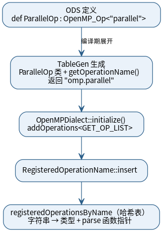
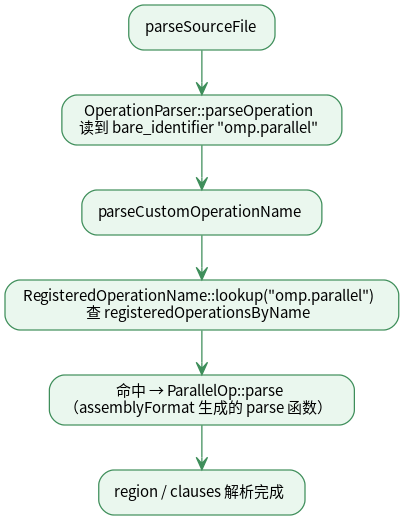
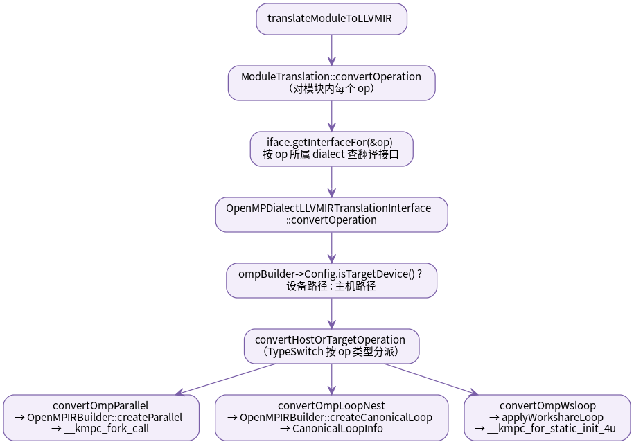
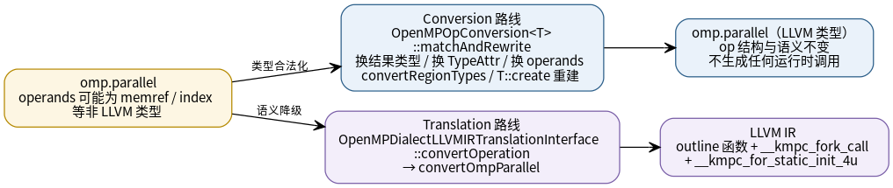
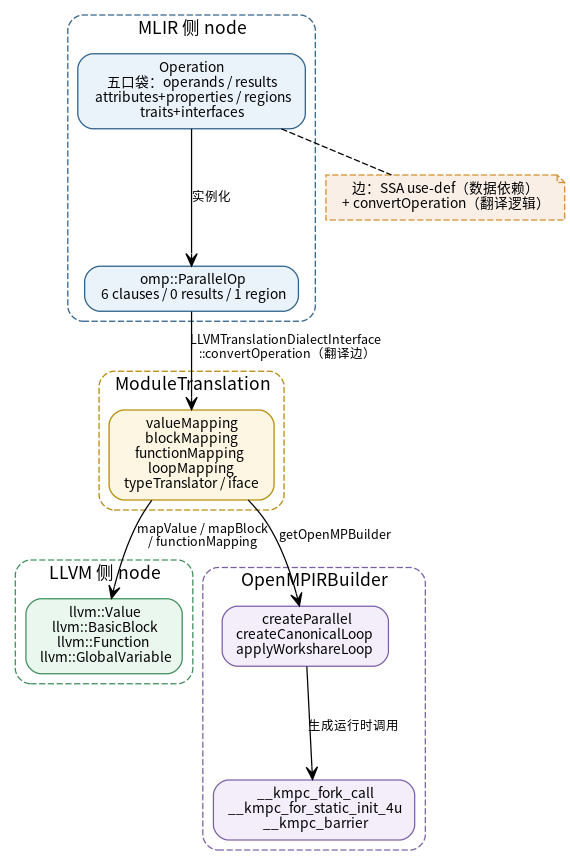

# 月度报告（2026 年 8 月）

> 主题：OpenMP/OpenACC Dialect 降级链路研究
> 说明：以源码定位与机制研究为主；图表仅标注类名/函数名，不标注文件路径；未验证项已标注。
> 图表源文件（可编辑）与渲染图位于 图表/ 目录。

## 一、当月研究进展

1. **OpenMP 降级链路源码定位**：完成 omp.parallel 从注册、解析到翻译的三级链路梳理，并厘清直译（语义降级）与 Conversion（类型合法化）两条路线的职责边界。
2. **OpenACC 完整降级可行性分析**：定位 OpenACC 直译的覆盖范围与 FIR→LLVM 阶段的类型适配缺口，形成改造方案（详见"后续计划"）。

## 二、阶段性研究成果

**1. 注册链（R1）**

ODS 定义经 TableGen 展开生成 op 类；dialect 初始化时通过 addOperations 把操作注册进
registeredOperationsByName 哈希表（字符串 → 类型 + parse 函数指针）。

**2. 解析链（R2）**

读文件阶段，parseCustomOperationName 用完整字符串 "omp.parallel" 查表，命中后调用
assemblyFormat 生成的 ParallelOp::parse 完成 region 与子句解析。

**3. 翻译链（R3）**

translateModuleToLLVMIR 对模块内每个 op 经 ModuleTranslation::convertOperation 按
dialect 路由到 OpenMP 翻译接口，isTargetDevice 分叉后由 convertHostOrTargetOperation
的 TypeSwitch 分派，最终由 OpenMPIRBuilder 生成 outline 函数与运行时调用。

**4. 两条降级路线的职责边界（R4）**

Conversion 路线只做类型合法化（重建同名 op，不生成任何运行时调用）；语义降级只发生在
Translation 路线（生成 outline 函数与 __kmpc_* 调用）。

**5. DAG 心智模型（R11）**

以 node（MLIR 侧 Operation、LLVM 侧 Value / BasicBlock / Function / GlobalVariable）
与 edge（SSA use-def 数据依赖、convertOperation 翻译逻辑）描述 IR 与翻译过程；
ModuleTranslation 的映射表与 OpenMPIRBuilder 是两图之间的桥梁。

## 三、存在问题

1. **AddAliasTagsPass 对包含 OpenACC 区域的处理存在缺陷**（待定：是否纳入本期报告）：
   对区域内 hlfir.declare 产生的 instantiation point 做 fir.declare 断言后访问 ODS 字段，
   触发越界崩溃（Release 下断言失效）。

## 四、后续计划

1. **OpenACC 完整降级**（本期不验证，列为下一步计划）：
   - 现状缺口：OpenACC 直译仅覆盖 data 类 op，compute 构造（acc.parallel / acc.loop /
     acc.private / acc.private.recipe）全部落入 unsupported 分支；FIR→LLVM 阶段无
     OpenACC 类型适配，导致 FIR 类型与 unrealized_conversion_cast 残留。
   - 改造方案：新增 OpenACCToLLVM 类型适配库（镜像 OpenMPToLLVM 的通用转换模板）并接入
     CodeGen；在 OpenACC 直译中实现 compute 构造的串行降级（acc.parallel inline region、
     acc.loop 复用 createCanonicalLoop、acc.private inline recipe init、recipe no-op）；
     完成后验证 try.f90.mlir 可完整降级为 LLVM IR。
2. **修复 AddAliasTagsPass**（条件项：若"存在问题"纳入第 1 条，则本项纳入后续计划）：
   修复其对 OpenACC 区域的处理缺陷，打通含 acc 构造的完整编译链路。
